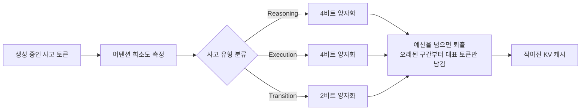
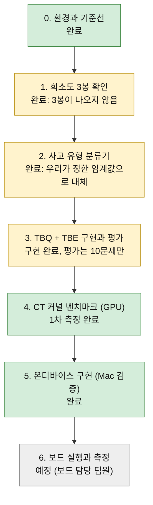
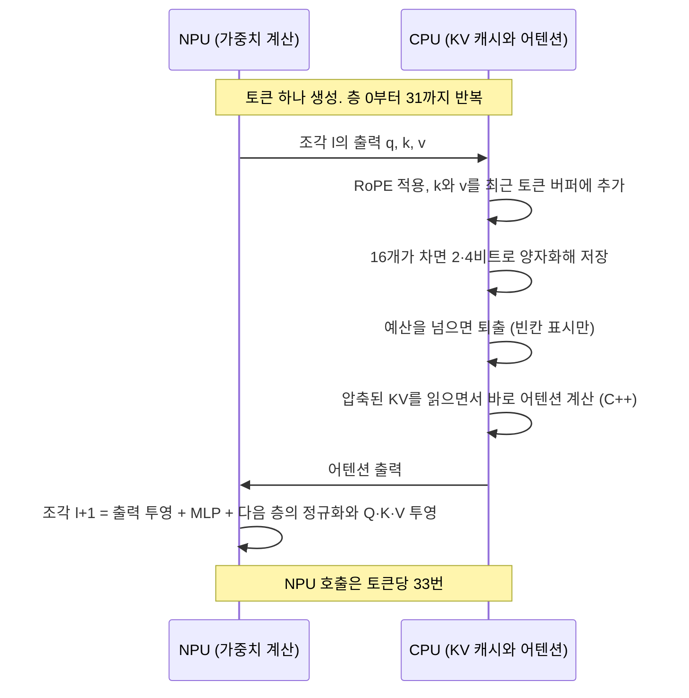
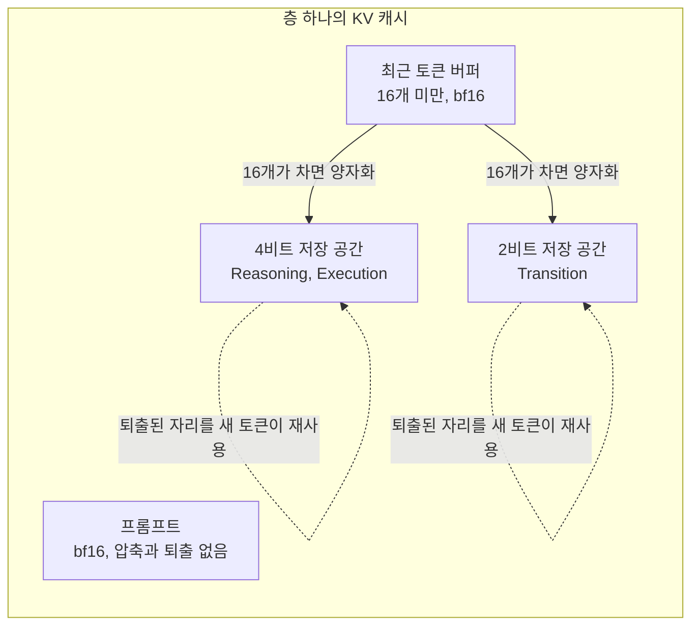

# capstone-thinkv

**ThinKV**([arXiv 2510.01290](https://arxiv.org/abs/2510.01290), ICLR 2026)를 재현하고, 그 KV 캐시 압축을 **Arduino VENTUNO Q 보드**(Qualcomm IQ-8275, RAM 16GB)에 올리는 캡스톤디자인 프로젝트.

마지막 갱신: 2026-11-20

## ThinKV가 하는 일

추론 모델은 답을 내기 전에 긴 사고 과정(CoT)을 생성하고, 그동안 KV 캐시가 계속 커진다. ThinKV는 사고 토큰을 세 유형으로 나누고 유형마다 다르게 줄인다.



- **TBQ**(유형별 양자화): 덜 중요한 유형은 더 적은 비트로 저장한다.
- **TBE**(유형별 퇴출): 예산을 넘으면 오래된 구간에서 K-means로 고른 대표 토큰만 남긴다.
- **CT**(Continuous Thinking): 퇴출한 자리를 복사 없이 빈칸으로 두고 새 토큰이 재사용한다.

## 진행 현황



| 단계 | 한 일 | 결과 | 자세한 곳 |
|---|---|---|---|
| 0. 환경과 기준선 | kvpress 위에서 무압축(FullKV)과 Knorm 실행 | 측정 경로 확인 | `eval/`, `results/`, `docs/stage0.html` |
| 1. 희소도 3봉 확인 | 논문은 희소도 분포에 봉우리 3개가 나온다고 한다. 미리 정한 기준으로 확인 | **나오지 않았다.** 아래 참조 | `docs/e3_*.md`, `calib/` |
| 2. 사고 유형 분류기 | 논문 방식의 임계값을 얻지 못해 대체 임계값으로 분류기를 만듦 | 측정 층 24, 최근 256칸 창의 희소도 사용 | `docs/e4_implementation_guide.md` |
| 3. TBQ + TBE | 양자화(값을 양자화한 뒤 16비트로 되돌려 저장)와 퇴출을 kvpress 위에 구현 | 10문제 평가, 아래 참조 | `thinkv/`, `docs/e4_tbe_tbq_design.md` |
| 4. CT 커널 | vLLM의 Triton 어텐션 커널을 가져와 빈칸 재사용을 붙이고 RTX 4090에서 측정 | 아래 참조 | `kernels/`, `docs/e10_ct_kernel_design.md` |
| 5. 온디바이스 구현 | 진짜 2·4비트 저장, C++ 어텐션, 모델을 NPU 조각으로 자르기 | Mac에서 테스트 19개 통과 | `ondevice/`, `docs/ondevice_npu_cpu_design.md` |
| 6. 보드 실행 | NPU 컴파일, 보드에서 속도와 메모리 측정 | 아직 없음 | `ondevice/README.md` |

## 단계별 결과

### 1. 희소도 봉우리 3개는 재현되지 않았다

- 결과를 보기 전에 판정 기준을 문서로 고정했다(`docs/e3_branch_a_criteria.md`).
- 작은 모델(R1-Distill-Qwen 1.5B, 7B)에서 기준을 통과하지 못했다(`docs/e3_branch_a_2type_fallback.md`).
- 논문과 같은 모델(R1-Distill-Llama-8B)로 논문 Algorithm 1을 그대로 돌렸다. 문제 9개에서 "모든 문제에서 봉우리가 3개인 층"이 하나도 없었다. 창 변형 4개와 워밍업 규칙 2개의 조합 8개 모두 같았다.
- 잔물결을 걸러내는 필터를 쓰면 분포는 사실상 봉우리 하나다.
- 논문이 KDE 폭을 밝히지 않아, 저자 설정에서도 같은지는 이 데이터로 단정할 수 없다(`docs/e3_paper_calibration_spec.md`).

### 3. TBQ + TBE 평가 (작은 표본)

AIME 2024 10문제를 한 번씩, R1-Distill-Llama-8B, 예산 1024토큰, 최대 생성 32,768토큰.

| 방식 | 실행 수 | 정답 | 32K에서 잘림 | 평균 캐시 길이 |
|---|---|---|---|---|
| 무압축 (FullKV) | 10 | 8 | 2 | 11,886 |
| SnapKV | 10 | 3 | 0 | 1,092 |
| TBE만 | 10 | 4 | 5 | 1,147 |
| 무작위 라벨 | 9 | 4 | 5 | 1,141 |
| 주기 라벨 | 6 | 4 | 3 | 1,126 |
| ThinKV (TBQ + TBE) | 10 | 2 | 6 | 1,133 |

- 캐시 길이는 무압축의 약 1/10로 줄었다.
- **정답 수는 논문 수준에 못 미친다.** 압축한 방식은 답을 내지 못하고 32K까지 생성하는 경우가 많다.
- 10문제를 한 번씩 돌린 결과라 방식 사이의 우열을 말할 수 없다.
- 균일 2비트, 균일 4비트, TBQ만 설정은 실행이 오염되어 표에서 뺐다(`thinkv/result/`의 `.contaminated` 파일).

### 4. CT 커널 (RTX 4090, 한 층 커널 시간 × 층 수)

프롬프트 128 + 생성 8,192스텝, 예산 1024. 비교 대상은 무압축, 퇴출 때 복사하는 방식(게더), 빈칸 재사용(CT).

| 비교 | 결과 |
|---|---|
| CT 대 무압축, 스텝 시간 | 2.97~5.79배 빠름 |
| CT 대 게더, 평균 스텝 시간 | CT가 14~18% 느림 (빈칸까지 훑기 때문) |
| CT 대 게더, 퇴출 스텝의 정지 시간 | CT가 1.9~37배 짧음 |
| CT 대 게더, KV 메모리 최댓값 | CT가 40% 적음 |

모델 전체 처리량이 아니고 합성 타임라인, 시드 1개다. 전체 표와 단서는 `docs/e10_ct_kernel_design.md` 9절.

### 5. 온디바이스 구현

Triton 커널은 NVIDIA·AMD GPU 전용이라 보드에서 돌지 않는다. 그래서 보드용 경로를 따로 만들었다. NPU는 모양이 고정된 계산만 받을 수 있어서 가중치 계산을 맡기고, 길이와 비트 수가 매 토큰 바뀌는 KV 캐시와 어텐션은 CPU가 맡는다.



KV 캐시는 세 구간으로 나눠 저장한다.



Mac 실측(R1-Distill-Llama-8B, bf16). 보드 측정값이 아니다.

| 항목 | 결과 |
|---|---|
| 토큰당 KV 메모리(층 하나) | bf16 4,096바이트 → 4비트 1,156바이트(3.5배), 2비트 644바이트(6.4배) |
| 기존 구현(`thinkv/press.py`)과 비교 | 생성 토큰, 유형 라벨, 퇴출 뒤 캐시 길이가 모두 같음 |
| C++ 어텐션의 오차 | 6,368번 계산 모두 허용 오차(1e-3) 안, 최대 2.2e-6 |
| 조각으로 자른 모델 대 원래 모델 | 같은 토큰 200개를 넣었을 때 출력 점수 최대 차이 7.6 (기준 10 이하) |
| 키 스케일 낭비 | 4,095토큰 생성 시 4비트 압축률이 3.5배에서 약 3.2배로 내려감 |
| Mac CPU 속도 | 약 6 tok/s |

## 남은 일

- 보드에서 NPU 조각 컴파일과 실행, 속도·메모리 측정 (보드 담당 팀원, 안내는 `ondevice/README.md`).
- NPU 호출 왕복 시간이 토큰당 33번을 감당하는지 확인. 감당하지 못하면 가중치 계산도 CPU로 옮기는 방안을 검토한다.
- 백로그: 퇴출 때 다시 묶어 재양자화하기, 1B급 모델 + 무압축 KV 대 8B + ThinKV 비교, 가중치·활성값·KV 정밀도별 속도 측정.

## 폴더 구조

```
eval/          0단계 기준선 실행과 비교
calib/         희소도 수집, 봉우리 분석, 분류 임계값 산출물
thinkv/        TBQ(quant.py), TBE(press.py), K-means, 평가 스크립트와 결과
kernels/       블록 장부(block_table.py), vLLM Triton 커널 이식, 벤치마크
ondevice/      보드용 구현: 압축 저장, C++ 어텐션, NPU 조각, 테스트
tests/kernels/ 커널 테스트
results/       0단계 결과, CT 커널 벤치마크 결과
docs/          단계별 설계 문서와 재현 보고서
```

## 실행

Python 3.12. 가상환경은 `.venv-kvpress`.

```bash
python -m venv .venv-kvpress
.venv-kvpress/bin/pip install torch transformers kvpress math-verify datasets pandas matplotlib tqdm scipy pytest

# 0단계 기준선
.venv-kvpress/bin/python eval/baseline.py
.venv-kvpress/bin/python eval/compare.py

# 커널 테스트 (GPU 테스트는 NVIDIA GPU에서만 돈다)
.venv-kvpress/bin/python -m pytest tests/kernels -q

# 온디바이스 테스트 (8B 모델, RAM 약 16GB, C++ 컴파일러 필요)
.venv-kvpress/bin/python -m pytest ondevice/tests -q -s
```

`docs/*.html`은 GitHub에서 소스로 보이므로 내려받아 브라우저로 연다.
