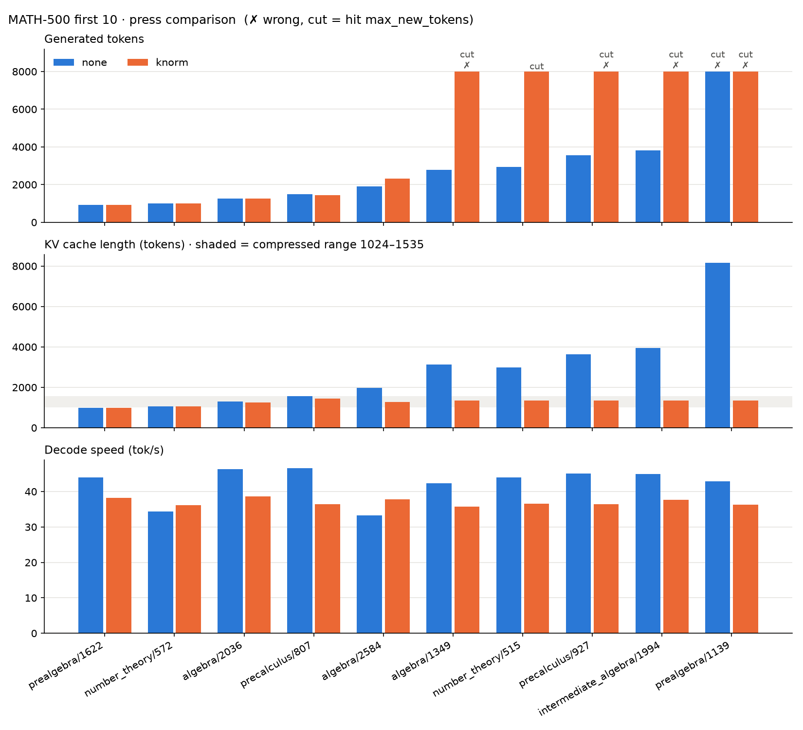

# capstone-thinkv

**ThinKV**([arXiv 2510.01290](https://arxiv.org/abs/2510.01290), ICLR 2026)를 [kvpress](https://github.com/NVIDIA/kvpress) 위에서 재현하는 캡스톤디자인 프로젝트.

ThinKV는 추론 모델의 긴 CoT를 어텐션 희소도로 Reasoning / Execution / Transition 세 사고 유형으로 나누고, 유형별로 KV 캐시를 다르게 압축한다(양자화 TBQ + 축출 TBE).

## 진행 상황

| 단계 | 내용 | 상태 |
|---|---|---|
| 0 | 환경 + FullKV·Knorm 기준선 | ✅ 완료 |
| 1 | 희소도 3봉 확인(E3, 분기점 A) | 진행 예정 |
| 2 | 온라인 사고 유형 분류기 | |
| 3 | TBE (사고 단위 축출) | |
| 4 | TBQ (사고 유형별 양자화) | |
| 5 | 조립·재현 판정(E4~E6) | |
| 6 | Continuous Thinking 커널(Triton) | |

## 구조

```
eval/baseline.py    MATH-500 앞 10문제를 press별로 생성·채점 → results/baseline_<press>.jsonl
eval/compare.py     결과 요약표 출력 + results/compare.png
results/            0단계 결과
docs/stage0.html    0단계 안내서
docs/stage1.html    1단계 안내서
HANDOFF.md          작업 상태, 검증한 사실, 결정 사항, 함정
```

`docs/*.html`은 GitHub에서 소스로 보이니 내려받아 브라우저로 연다.

## 실행

Python 3.12. Apple Silicon(MPS)에서 확인했다. 장치는 mps → cuda → cpu 순으로 자동 선택한다.

```bash
python -m venv .venv-kvpress
.venv-kvpress/bin/pip install torch transformers kvpress math-verify datasets pandas matplotlib tqdm
.venv-kvpress/bin/python eval/baseline.py   # none, knorm 순서로 실행. 이미 있는 (문제, 시드)는 건너뜀
.venv-kvpress/bin/python eval/compare.py
```

모델은 `deepseek-ai/DeepSeek-R1-Distill-Qwen-1.5B`(bf16), 데이터는 `alessiodevoto/math500`.

## 0단계 결과

MATH-500 앞 10문제, 시드 0, `max_new_tokens=8000`, temperature 0.6, top_p 0.95.
knorm = `DecodingPress(KnormPress(), compression_interval=512, target_size=1024)`.

| | none (FullKV) | knorm |
|---|---|---|
| 정답 | 9/10 | 6/10 |
| 8000토큰에서 잘림 | 1 | 5 |
| 평균 생성 길이 | 2769 | 4696 |
| 초당 토큰(중앙값) | 44.0 | 36.5 |

knorm은 none이 3천 토큰 안팎에서 끝낸 문제 4개를 전부 8000까지 생성했다. 축출 때문에 결론을 못 내고 길어지는 것으로 보인다.
로컬 10문제·시드 1개 결과라 정확도 비교가 아니라 환경과 측정 경로를 확인하는 용도다.


